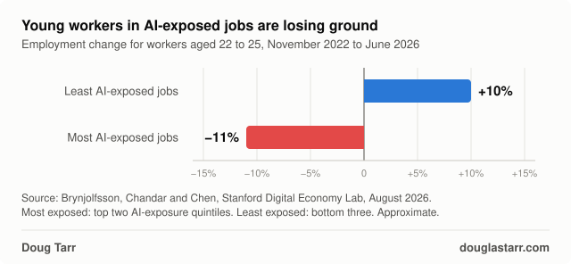
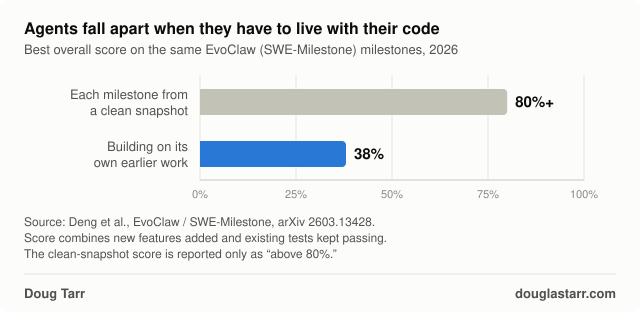
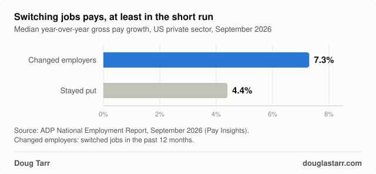

Agents won't take over software engineering until they've had to do it for as long as you have. So you probably have a few years, at minimum.

Stanford researchers working from ADP payroll data found that [employment for workers aged 22 to 25](https://digitaleconomy.stanford.edu/app/uploads/2026/08/Canaries_August2026.pdf) in the jobs most exposed to AI, software development among them, fell about 11% between November 2022 and June 2026. In the least exposed jobs, it grew about 10%. The low end is already feeling it. Junior work is well-scoped tasks with a clear definition of done, and that's the work agents are good at.

Lovable users have created [more than 60 million projects](https://www.unite.ai/lovable-series-c-doubles-the-vibe-coding-startups-valuation-to-13-3-billion/) since launch. Most of them start the same way: you type a prompt, and a few minutes later you have a working app. That's where the energy in agentic development goes right now. Day one.

The benchmarks follow the energy. Most coding benchmarks hand an agent one task in a fresh copy of a repo, grade the result, and then [reset everything to a known-good state](https://arxiv.org/abs/2604.03035) before the next task. Nothing the agent did yesterday follows it into today. The agent never has to live with its own code.

## the consequences

[EvoClaw](https://arxiv.org/abs/2603.13428) (since renamed SWE-Milestone) tests the other thing. Researchers from USC, UC Riverside and Yale rebuilt the release history of seven open source projects as chains of dependent milestones. The agent works through them in order, on the codebase it has been building, so early decisions constrain later ones.

When each of these milestones starts from a clean snapshot, frontier agents score above 80%. In the continuous setting, the paper's [best system scored 38%](https://openhands.dev/blog/evoclaw-benchmark) (Claude Opus 4.6 with OpenHands). The best resolve rate, meaning milestones where every test passed, was 13%.

The way they fail is the interesting part. The agents kept adding new features at a steady pace. What they couldn't do was keep the old ones working. Regressions piled up faster than the agents could fix them, until the codebase got too fragile to change without breaking something.

## the job hopper

When I was hiring at MongoDB, I hired many great engineers from great companies. One pattern was a red flag for me: continuous job hopping.

You can only learn so much on a project in one or two years. You make the early decisions, you ship, and you leave before those decisions come due. Someone else gets the 2am page. Someone else finds out the shortcut doesn't hold at ten times the load. The real learning in designing and building robust distributed systems comes from working through the consequences of your early decisions. Job hoppers skip that part every time.

They skip it because switching pays, at least in the short run. In ADP's September data, people who had changed employers in the past year saw [median gross pay growth of 7.3%](https://mediacenter.adp.com/2026-09-30-ADP-National-Employment-Report-Private-Sector-Employment-Increased-by-90,000-Jobs-in-September), against 4.4% for people who stayed. The reward arrives right away. The bill for the early decisions arrives later, and someone else pays it.

Agents chase the same kind of reward. For a year and a half, SWE-bench Verified was the headline number for coding agents. In February 2026 OpenAI [stopped reporting it](https://openai.com/index/why-we-no-longer-evaluate-swe-bench-verified/). Frontier models could reproduce some of the answer patches from memory, and when OpenAI audited 138 problems its o3 model couldn't reliably solve, at least 59.4% had tests that rejected correct solutions. The number had stopped measuring how well agents code.

A benchmark score is an agent's raise and new title. Both are short term. Both get measured on a task that ends before the consequences show up.

Today's agents are the ultimate job hoppers. Every task is a new job, and every benchmark is a promotion. They show up, build something impressive, collect the score, and they're gone before the consequences arrive.

## knowing where to tap

There's an old story about an engineer called in to fix a broken machine. He listens for a minute, taps one spot with a hammer, and it starts running again. Then he sends a bill for $1,000. When the owner asks for an itemized invoice, it reads: $1 for the tap, $999 for knowing where to tap.

In March 2026, METR had maintainers of scikit-learn, Sphinx and pytest [review 296 AI-written pull requests](https://metr.org/notes/2026-03-10-many-swe-bench-passing-prs-would-not-be-merged-into-main/) that had already passed SWE-bench's tests. Even after adjusting for how often those maintainers turned down human-written patches, roughly half of the AI patches wouldn't have made it into main. The maintainers flagged code that ignored the project's standards, fixes that broke other code, and patches that didn't solve the actual issue. (The agents dated from mid-2024 to late 2025, and each got one try with no chance to respond to review.) Passing the tests was the $1. The maintainers supplied the $999.

Even if you've had agents working on a project continuously, I'd be surprised if you, as the engineer or owner, aren't providing most of the long-term value. You decide what to build next. You notice when the architecture starts drifting. You know which shortcut will hurt in six months. The agent supplies the tap.

Few agents have built a system and then run it for a year. That's where the value is, and it's where the learning is.

If you've had an agent maintain something for more than a few months, I'd like to hear how it went, and how much of the knowing-where-to-tap was you.
